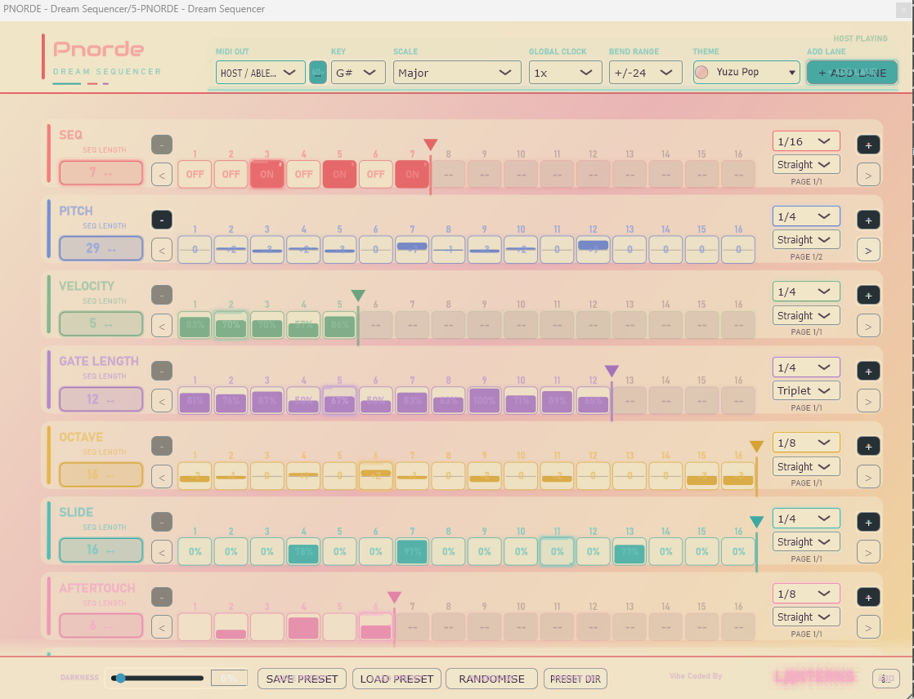
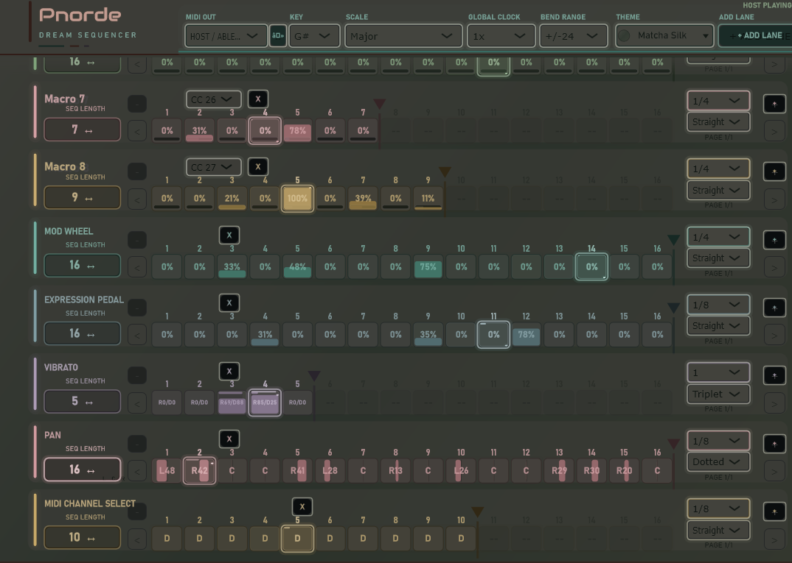
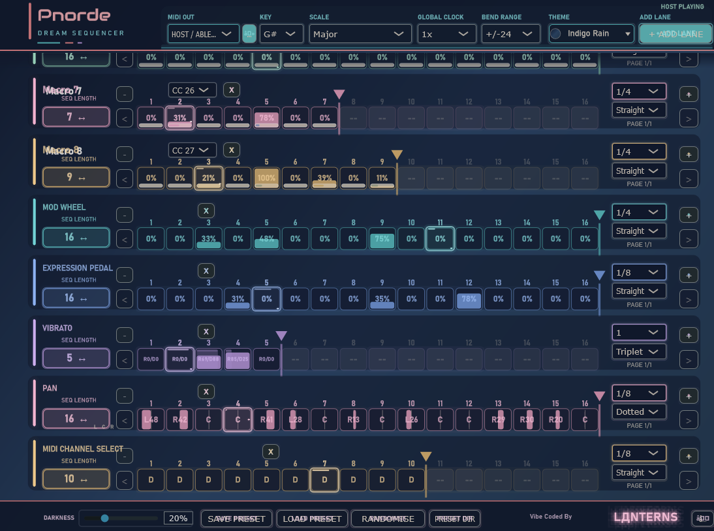

# PNORDE — Dream Sequencer

**Free and open-source polyrhythmic / polymetric MIDI sequencing instrument.**  
**First public alpha: v0.5.2-alpha.1 · Windows x64 VST3**

**[Download the VST3 HERE!](https://github.com/alteredwavestudios/PNORDE/releases/download/v0.5.2-alpha.1/PNORDE-v0.5.2-alpha.1-Windows-x64-VST3.zip)**

**Original concept, creative direction, sequencer architecture and initial programming:** **LANTERNS (Nova O'Reilly)**  
**Studio:** Altered Wave Studios  
*Vibe Coded By LДNTERNS* ✨

## What is PNORDE?

PNORDE is a C++/JUCE MIDI sequencer for experimenting with independent rhythms and evolving modulation. Rather than forcing every parameter onto one grid, individual lanes have their own step lengths and clock divisions. Pitch, velocity, gate length, slides, CC modulation and MIDI channels can trace different cycles and create emergent patterns.

PNORDE takes **creative inspiration from Arturia Pigments** and its expressive visual modulation environment, and **VCV Rack** and its modular clock-driven circuitry. The project is independent and is **not affiliated with or endorsed by Arturia or VCV Rack**.

## Screenshots

### Yuzu Pop — light theme

### Matcha Silk — dark theme

### Indigo Rain — dark theme

## Features

- Polyrhythmic/polymetric sequences: independently adjustable lane lengths and clock divisions.
- Note sequencing, pitch/scale control, velocity, gate length, octave, slide, and aftertouch.
- Up to eight assignable MIDI CC Macro lanes and dedicated Mod Wheel, Expression, Vibrato, Pan, Sustain and MIDI Channel lanes.
- MIDI output to DAW host and supported Windows external MIDI devices.
- Preset saving/loading (`.pnorde`), preset directory selection, pattern randomisation and automatable global controls.
- Multiple colour themes, glowing circuit-inspired UI, clock-responsive lights and adjustable darkness.

## Download and install (Windows x64)

1. Open **Releases** and download `PNORDE-v0.5.2-alpha.1-Windows-x64-VST3.zip`.
2. Close your DAW, unzip it, and copy the entire `PNORDE - Dream Sequencer.vst3` **folder** into `C:\Program Files\Common Files\VST3\` (administrator permission may be needed).
3. Launch your host, rescan VST3 plugins, and load **PNORDE - Dream Sequencer**.

**Host tested by the creator:** Ableton Live 12 on Windows 11. Other hosts/platforms are not yet verified. No AAX, AU, or other plugin binaries are supplied in this alpha.

## Build from source

Requires **JUCE 8**, **CMake 3.22+**, and **Visual Studio 2026 with the Desktop development with C++ workload**. JUCE is **not bundled**. See `BUILDING.md` for commands. PNORDE currently targets the `PnordeDreamSequencer_VST3` CMake target.

## Open source and contributions

The project is intended to be distributed under **GNU AGPLv3**. See `LICENSE` and `ATTRIBUTION.md`; please retain applicable original authorship and copyright notices when redistributing, and clearly mark changes in forks. The **PNORDE** name and Altered Wave Studios branding are used for the official project; forks must not imply official endorsement. See `TRADEMARKS.md`.

**Before public publication:** confirm the rights to redistribute the embedded Audiowide font data in `Source/AudiowideEmbedded.h` and complete the project's rights/licensing review (see `RELEASE_CHECKLIST.md`).

Bug reports, feature requests and pull requests are welcome. This is an **alpha**, so save important projects and report reproducible issues.

## Creator / socials

**LANTERNS (Nova O'Reilly)** — original concept, creative direction, sequencer architecture and initial programming.  
**Altered Wave Studios**  
🎵 [Bandcamp — LANTERNS](https://l4nterns.bandcamp.com/)  
📷 [Instagram — @alteredwave.media](https://www.instagram.com/alteredwave.media/)

*Vibe Coded By LДNTERNS* 💜

